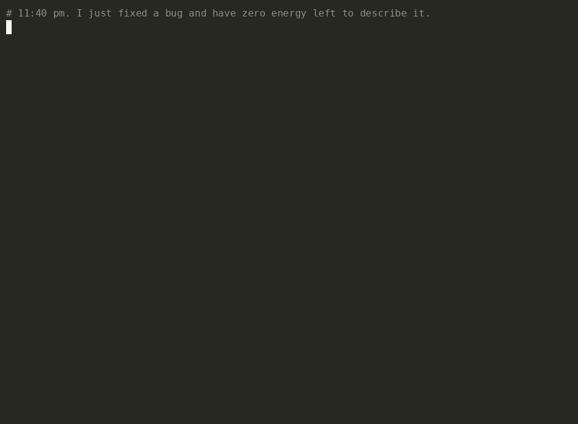

# 🦥 SlothCommit

**Let a local Gemma model do the git chores you keep putting off.**
Writes your commit messages, your weekly "what did I even do" report, and
(if you're truly committed to laziness) fills in `git commit` for you.
Offline. Free. Your code never leaves your machine.



```text
$ git add -A && sloth commit
🦥 Gemma via llama-server: 4.8s. Nothing left this machine.

fix(cli): add GPA calculation fix

- Fixed a potential error in the GPA calculation by adding a check for
  unknown grades and raising an UnknownGradeError
...
```

*(That's a real, unedited output from Gemma 3 **1B**. It's a first draft, not
an oracle: `sloth commit` asks Yes / Edit / No before committing.)*

## What it does

| Command | Chore it removes |
|---|---|
| `sloth commit` | reads `git diff --cached`, writes a [Conventional Commit](https://www.conventionalcommits.org/), asks `[Y]es / [e]dit / [n]o` |
| `sloth msg` | just prints the message (pipe it anywhere) |
| `sloth week` | turns the last 7 days of commits into a standup-ready summary + grouped changelog; `--lang zh` for 中文 |
| `sloth hook install` | `prepare-commit-msg` hook: plain `git commit` arrives pre-filled. Never blocks a commit if the model is down |

## Why a 1B model is enough (with some help)

A tiny model on a CPU needs guard rails, so SlothCommit only asks Gemma for
the part that actually needs language understanding:

* **Schema-constrained output.** Gemma must answer with JSON matching
  `{type, scope, subject, body}`; llama.cpp compiles the schema into a grammar,
  so the output is always parseable and `type` is always a valid commit type.
* **Rules in Python, not in the prompt.** If only Markdown changed, the schema's
  `type` enum is narrowed to `docs` before Gemma sees it (same for tests, CI,
  and brand-new code files → `feat`).
  Scope cleanup, 72-char headers, body wrapping and dedup are plain code.
* **Few-shot, cached.** Three tiny unrelated examples teach the format;
  `llama-server` caches that prefix, so a warm request only reads your diff.
* **Big diffs get condensed, not truncated.** Lockfiles and minified files are
  dropped from the patch (kept in `--stat`). A patch over ~2.5k characters is
  reduced to each file's definitions, comments and docstrings, and Gemma is
  told to skip the bullet points, because with only an outline its "details"
  are mostly invented.
* **A homework-copying detector.** On big unfamiliar diffs a 1B model sometimes
  just repeats a few-shot example. If the subject matches one, SlothCommit says
  so and falls back to a plain, true message built from the file list.
* **No hallucinated changelogs.** `sloth week` groups commits by type in code;
  Gemma only writes the 2-4 sentence summary on top.

## Install

```bash
pip install git+https://github.com/ziwenqingshu/slothcommit
```

Then pick **one** place for Gemma to live. SlothCommit's default
`--backend auto` uses whichever is running: llama-server → Ollama → in-process.

### Option A: llama.cpp server (fastest, recommended)

```bash
# macOS: brew install llama.cpp   |   Linux/Windows: grab a build from
# https://github.com/ggml-org/llama.cpp/releases
llama-server -hf unsloth/gemma-3-1b-it-GGUF:Q4_0 -c 4096 --port 8080
```

Use `SLOTH_SERVER_URL` if it's not on `http://127.0.0.1:8080`.

### Option B: Ollama

```bash
ollama pull gemma3:1b      # ~800 MB, once
ollama serve               # if it's not already running
sloth --backend ollama commit
```

`SLOTH_OLLAMA_MODEL=gemma3:4b` if your machine has room for a smarter sloth.

### Option C: no daemon at all (llama-cpp-python)

```bash
pip install "slothcommit[llamacpp] @ git+https://github.com/ziwenqingshu/slothcommit"
sloth --backend llamacpp commit     # downloads gemma-3-1b-it-Q4_0.gguf (~720 MB) once
```

Point `SLOTH_MODEL=/path/to/any-gemma.gguf` at a file you already have.
Honest warning: on my 2-vCPU test box this path was ~14x slower than
llama-server (see [docs/BENCHMARKS.md](docs/BENCHMARKS.md)).

## Usage

```bash
git add -A
sloth commit                 # review, then commit
sloth commit -y --no-body    # maximum sloth: one line, no questions
sloth commit --hint "closes #12"
sloth week                   # last 7 days, your commits only
sloth week --since "last monday" --all --lang zh -o weekly.md
sloth week --no-ai           # changelog only, no model
sloth hook install           # now plain `git commit` is pre-filled
```

| Env var | Default |
|---|---|
| `SLOTH_BACKEND` | `auto` (`server`, `ollama`, `llamacpp`) |
| `SLOTH_SERVER_URL` | `http://127.0.0.1:8080` |
| `OLLAMA_HOST` / `SLOTH_OLLAMA_MODEL` | `http://127.0.0.1:11434` / `gemma3:1b` |
| `SLOTH_MODEL` | `~/.cache/slothcommit/gemma-3-1b-it-Q4_0.gguf` |
| `SLOTH_THREADS` | all cores |

Requests to local backends deliberately bypass `HTTP(S)_PROXY`, so a system proxy
can't route your diff anywhere.

## Performance (measured, not vibes)

2 vCPU ARM cloud box, no GPU, Gemma 3 1B Q4_0 via llama-server:
**2.2-4.8 s per commit message** (mean 3.4 s over 8 commits),
**3-4.7 s per weekly report**, ~1.6 GB RAM. Full table and caveats in
[docs/BENCHMARKS.md](docs/BENCHMARKS.md).

## 中文快速上手

SlothCommit 用**本地运行的 Gemma 3 1B** 帮你写 git 提交信息和每周工作小结，完全离线、免费，代码不会上传到任何服务器。

```bash
pip install git+https://github.com/ziwenqingshu/slothcommit

# 二选一：启动本地模型
llama-server -hf unsloth/gemma-3-1b-it-GGUF:Q4_0 -c 4096 --port 8080
# 或者
ollama pull gemma3:1b

git add -A
sloth commit            # 生成 Conventional Commit 提交信息，确认后提交
sloth week --lang zh    # 生成中文“本周小结” + 更新日志，可直接发组会群/导师
sloth hook install      # 以后直接 git commit 就会自动填好提交信息
```

提示：
- Hugging Face 下载慢的话可以设置 `HF_ENDPOINT=https://hf-mirror.com`，或者手动下载 GGUF 后用 `SLOTH_MODEL=/路径/模型.gguf` 指定。
- 本地后端请求会绕过系统代理，开着代理也不会把代码发出去。
- 1B 模型写的是“初稿”，`sloth commit` 默认会让你确认或编辑。

## Development

```bash
pip install -e ".[dev]"
pytest -q        # 30 tests, no model needed (a fake backend stands in for Gemma)
```

`docs/demo_repo_steps.py` rebuilds the sample repo from the demo, and
`docs/demo_script.sh` is the exact script recorded with asciinema + agg.

## Credits & license

MIT © 2026 Zhixin Qin. Gemma is provided under the
[Gemma Terms of Use](https://ai.google.dev/gemma/terms). Full list of the
open-source projects this builds on in [CREDITS.md](CREDITS.md).
